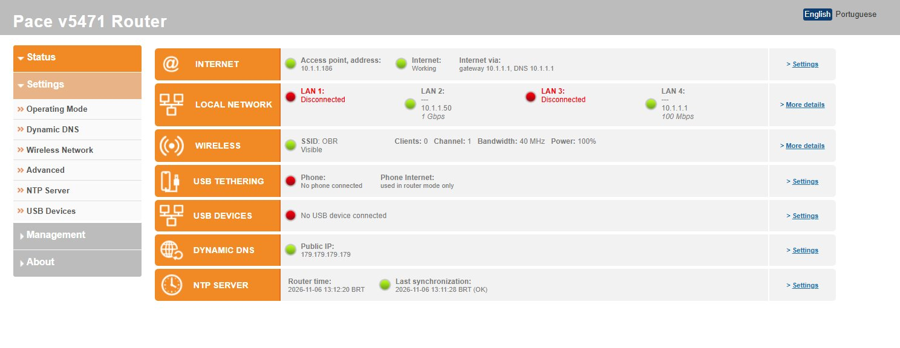
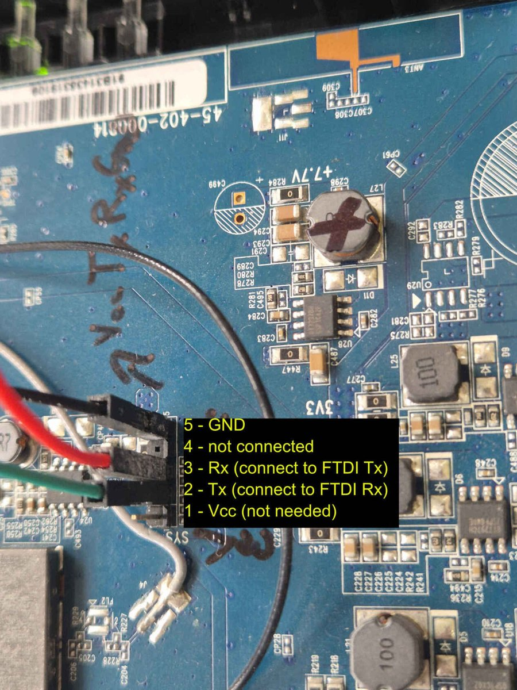
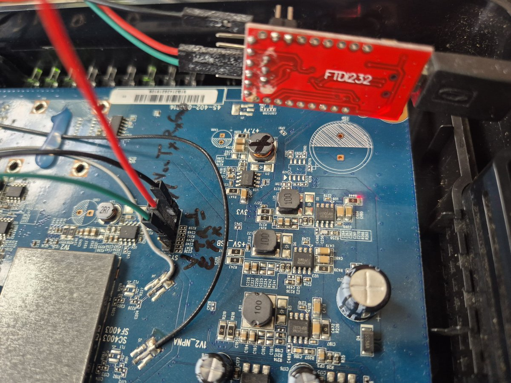

# Modified firmware for the Pace V5471

**English** | [Português](README.md)

Custom firmware for the **Pace V5471** home gateway (sold in Brazil by GVT / Vivo as "Power Box"),
turning it into a modern **Wi-Fi access point** or a small **router** with USB tethering failover,
dynamic DNS, DNS over TLS and a reworked web interface in English and Portuguese.

It is built on top of [alacn1](https://github.com/alacn1)'s *Alacn-181231* firmware (itself based on
the GVT stock firmware 104452), with the DSL / VoIP / IPTV / TR-069 parts removed, current versions
of the network daemons, and a set of new pages and services.



---

## Contents

- [Hardware](#hardware)
- [Features](#features)
- [Default settings](#default-settings)
- [Installing](#installing)
  - [Serial console (UART)](#serial-console-uart)
  - [Test without flashing (RAM boot)](#test-without-flashing-ram-boot)
  - [Flashing](#flashing)
  - [Recovery](#recovery)
- [Building](#building)
- [Repository layout](#repository-layout)
- [Known limitations](#known-limitations)
- [Credits](#credits)

---

## Hardware

| | |
|---|---|
| SoC | Broadcom BCM63168 (BMIPS4350, MIPS32 big-endian, 400 MHz, SMP kernel) |
| RAM / flash | 128 MB DDR3 / 128 MB NAND (Spansion S34ML01G1), dual firmware banks |
| Ethernet | 4 × LAN + 1 × WAN (eth4) |
| Wi-Fi | Broadcom 802.11b/g/n 2.4 GHz, 2×2, `wl` driver 6.30.102.3 |
| USB | 1 × USB 2.0 (phone tethering, 3G modem, printer) |
| Software base | Linux 2.6.30 (Broadcom SDK), busybox 1.17, Bewan "configd" configuration system |
| Product code | B14103 |

---

## Features

### Operating modes (Settings → Operating Mode)
- **Access point** (default): the device joins your main router's network as a bridge; management
  address by DHCP (or fixed), rescue address `169.254.25.1`. The Wi-Fi and the 4 LAN ports are part of
  the main network.
- **Router**: Internet on the WAN port by **PPPoE** (service name, VLAN tag, MAC clone), **DHCP** or
  **fixed IP**; LAN `192.168.25.1/24` with DHCP server; firewall, port forwarding, UPnP (off by default).
  Optional **isolation from the WAN-side network** (LAN clients reach the Internet but not the devices
  of the network the WAN port is plugged into).

### Internet and USB
- **Android USB tethering** (RNDIS / CDC Ethernet modules built for this kernel): in router mode a
  phone on the USB port **takes over automatically when the WAN is down** and gives the connection
  back when it returns (probes through each link, configurable monitoring addresses).
- The phone link is firewalled like the WAN (nothing new comes in from it).
- 3G USB modem page (APN, PIN, login).
- USB printer server.

### Wi-Fi (Settings → Wireless Network)
- Security mode list with **WPA2 (best)** first, password **strength meter** and a **Generate** button
  (16 random characters, ~93 bits).
- **Connected devices** list: name, IP, MAC, 802.11 mode and channel width (from the link rate),
  connection time, signal, tx/rx rate, with buttons to **Block** (MAC filter) or give a **Fixed IP**
  (DHCP reservation).
- **Client isolation**: a default for Wi-Fi devices (allow LAN access / isolate) plus an **Isolate**
  switch per device. Isolated devices only reach the Internet and the router's DNS/DHCP.
- MAC filter in **allow** or **deny** mode.

### DNS and time
- **dnsmasq 2.93** (instead of 2.45 from 2008) with **DNS rebinding protection**.
- **DNS over TLS** to Cloudflare, Quad9 or Google (own small forwarder on mbedTLS 3.6, certificate
  and name verified), Internet page.
- **Dynamic DNS** page with several accounts at once: dns.army / dynv6, nsupdate.info (IPv4 / IPv6),
  cPanel or any custom update URL, plus the stock providers. Updates over HTTPS (static curl 8.10 with
  TLS 1.3 and the Mozilla CA bundle), every 5 minutes and at every connection, waiting for the Internet
  and the clock at boot; per-account **Update now** button and run log.
- **NTP Server** page: servers, time zone (Brazil without daylight saving time), **Update now**
  button with log; synchronizes through the LAN in AP mode and through the WAN in router mode.
- mDNS: the device answers as `<hostname>.local` (default `paceap.local`).

### Security
- Web password asked to be changed at the first login; login blocked for 30 min after 5 wrong attempts.
- **SSH** (dropbear 2026.94, ed25519 host key unique to each device, kept across upgrades) and Telnet
  are **off** by default; a separate shell user `shell` with its own password (Account Settings).
- UPnP, WPS, Telnet, TR-069, WAN ping answers off; the Broadcom auto-channel daemon's unauthenticated
  port closed to the network.
- See [Known limitations](#known-limitations) for what the hardware can't do (WPA3).

### Status and maintenance
- **Status** page: Internet (or, in AP mode, the AP's address and Internet through the main router),
  LAN ports with devices and link speed, Wi-Fi, USB tethering, USB devices, Dynamic DNS, NTP. The header
  reads "Pace v5471 Access Point" or "Pace v5471 Router" by mode.
- **Logged errors notice**: real problems found in the logs (script errors, crashes, watchdog
  reboots) are kept in flash and shown on the Status page as "There are X logged errors that need
  examination", with *Show* and *Mark as examined*.
- System Logs sorted newest first; descriptions next to every setting; English / Portuguese UI with
  the language remembered; firmware upgrade from the web page (dual bank).
- The main router sees the device by name (`PaceAP`, DHCP option 12) and by manufacturer (the unit's
  own Pace MAC address instead of a locally administered one).

---

## Default settings

| Setting | Default |
|---|---|
| Mode | Access point, management address by DHCP from your main router |
| Rescue address | `169.254.25.1/16` (only reachable from a PC cabled directly, without DHCP) |
| Web interface | `http://<address>/` or `http://paceap.local/`, user **admin**, password **admin** (a new one is asked) |
| Router-mode LAN | `192.168.25.1/24`, DHCP `.2`–`.240` |
| Wi-Fi | as printed on the device's label (SSID and WPA key); WPS off |
| SSH / Telnet | off; user `shell`, no password until set on Account Settings |
| DNS | rebinding protection on, DNS over TLS off |
| Time | NTP `0/1/2.pool.ntp.org`, time zone Brasília (UTC−3) |

To find the access point's address, look for **PaceAP** in your main router's DHCP leases, or open
`http://paceap.local/`.

---

## Installing

> Flashing custom firmware can brick the device if something goes wrong. The V5471 has two firmware
> banks and a boot loader that can RAM-boot an image from the network, so recovery is usually
> possible, but you do this at your own risk.

### Serial console (UART)

A serial console is not needed to install through the web page, but it is the way to see what the
device does and to recover it. The board has a 5-pin header (marked `SYS`, near the `3V3` / `+5V_USB`
regulators):



| Pin | Signal | Connect to the USB-serial adapter |
|---|---|---|
| 5 | GND | GND |
| 4 | — | not connected |
| 3 | Rx (router receives) | adapter **TX** |
| 2 | Tx (router sends) | adapter **RX** |
| 1 | Vcc | **not connected** (the router powers itself) |

- **3.3 V levels**: set the FTDI (FT232) adapter's voltage jumper to **3.3 V**, never 5 V.
- Settings: **115200 baud, 8N1**, no flow control. A root shell (`~ #`) is available on the console.
- Avoid sending `^` (caret) over this console: it is a SysRq trigger here.



### Test without flashing (RAM boot)

The boot loader can boot an image sent over the network without writing it to flash ("multicast
mode"):

1. Connect the PC by cable to a **LAN** port of the V5471, and to no other network.
2. Give the PC a fixed address such as `192.168.25.10/24` and keep `ping 192.168.25.1` running.
3. Power the V5471 on **holding the WPS button**.
4. Send the image:
   ```
   python3 -I tools/v5471fw.py send work/build/cyberponk-vX.Y.Z.bin [pc-ip]
   ```
5. The device boots the image from RAM; if anything fails, the next power cycle boots from flash.

### Flashing

From a running alacn or cyberponk firmware (including a RAM-booted one):

- **Web interface**: Management → Firmware, upload `cyberponk-vX.Y.Z.bin`. The image goes to the
  older bank and becomes the next to boot; the checksum is verified first.
- **Serial console**:
  ```
  cd /var/tmp && wget http://<pc>:<port>/cyberponk-vX.Y.Z.bin -O ni.bin
  fwburn -t -v ni.bin      # check the image
  fwburn -b ni.bin         # write it to the older bank (about 2 minutes, don't power off)
  fwburn -t -i             # both banks and their boot order
  reboot
  ```

Settings are kept across upgrades. From the **stock GVT firmware**, RAM-boot a cyberponk image first
and flash it from its own Firmware page.

### Recovery

- The **other bank** keeps the previous firmware: if a new image doesn't work, the loader boots the
  bank with a valid checksum, and an older image can be flashed again from the web page or console.
- **RAM boot** (above) works even when both banks fail to start properly.
- **Factory reset**: Management → Resets, or hold the reset button; the device comes back in access
  point mode with the defaults above.

---

## Building

Builds run on Linux without root (ownership and device nodes are kept in a fakeroot state file).

**Needed:** Python 3 (with Pillow for `tools/re/icons.py` only), `fakeroot`, `squashfs-tools`
(`unsquashfs` / `mksquashfs` with LZMA), `openssl`, `node` (page tests), `dash` (shell syntax checks).

**Inputs, not in git:**

| Path | What |
|---|---|
| `Downloads 2026-10-26/alacn1/alacn-181231-g7b2ba89.bin` | alacn1's Alacn-181231 image (from the alacn1 `pace_v5471` project): kernel, header and root filesystem base |
| `work/toolchain/mips32--musl--stable-2018.02-2/` | Bootlin musl toolchain: static binaries that run on kernel 2.6.30 |
| `work/toolchain/mips32--glibc--stable-2018.02-2/` | Bootlin glibc toolchain: kernel modules |
| `work/ref/nomis/` | Broadcom SDK 4.12L.06B kernel tree ([nomis/bcm963xx_4.12L.06B_consumer](https://github.com/nomis/bcm963xx_4.12L.06B_consumer)) for the USB modules |
| `work/re/{curl,dnsmasq,dropbear}/src/` | upstream source tarballs (checked by hash / GPG signature in the build scripts) |

**Third-party binaries** (once, or after changing their scripts):

```
tools/re/modules/build.sh   # usbnet, cdc_ether, rndis_host (USB tethering)
tools/re/curl/build.sh      # static curl 8.10.1 + mbedTLS 3.6.2, CA bundle
tools/re/net/build.sh       # dnsmasq 2.93, dropbear 2026.94, dotproxy (DNS over TLS)
```

**Firmware:**

```
tools/make_rootfs.sh        # fresh extract of the alacn image + tools/strip.sh + tools/configure.py
tools/tests/run.sh          # offline checks: page logic (mock DOM), JS and shell syntax,
                            # commands missing on the device, ELF library dependencies
tools/build.sh              # -> work/build/cyberponk-v<VERSION>.bin
```

The version comes from `VERSION` (`MAJOR.MIDDLE.MINOR`) and is shown in the web interface
(`cyberponk-vX.Y.Z`): the last number goes up for each test build, the middle one for each release
(tagged `vX.Y.Z`).

---

## Repository layout

| Path | Contents |
|---|---|
| `tools/configure.py` | the customization: factory defaults, configuration schema additions, web page edits, CSS |
| `tools/strip.sh` | removed features (DSL, VoIP, TR-069, Samba, DLNA, GVT hotspot / set-top box, ...) |
| `tools/overlay/` | new files copied into the root filesystem: pages, scripts, `tetherd`, init handlers |
| `tools/i18n_pt_BR.py` | Portuguese texts of the new pages (generated from the English ones) |
| `tools/descriptions.py` | the setting descriptions shown on the stock pages |
| `tools/v5471fw.py` | image tool: info / extract / build / RAM-boot send (Python port of alacn's `updatefw`) |
| `tools/tests/` | offline tests |
| `tools/re/` | build scripts for the third-party binaries, the DNS over TLS forwarder source, icons, serial and web preview helpers, reverse-engineering notes |
| `docs/images/` | pictures used in this README |

---

## Development notes

- configd runs the `onchange` handlers by *sourcing* `/etc/bewan/init.d/<service>` (dash, `set -u`):
  a missing file or an `exit` breaks configd's lock. Removed services get no-op stubs, never deletion.
- `/bin/sh` is a patched dash: a fatal script error, including a command that doesn't exist, stops the
  software watchdog and the router reboots about a minute later. New scripts are `#!/bin/ash`, and
  `tools/tests/run.sh` refuses commands busybox 1.17 lacks (`tee`, `cmp`, `readlink`, `timeout`, ...).
- Password parameters (`type="password"`) are stored AES-256-ECB encrypted; see `bewan_encrypt()` in
  `tools/configure.py`.
- The firmware flushes its iptables / ebtables chains on every WAN/LAN event: rules added by this
  project are re-asserted every 5 s (`tools/overlay/etc/bewan/lib/ni-guard`, run by `tetherd`).
- Test new images by RAM boot first, flash only after that.

---

## Known limitations

- **No WPA3 / 802.11w**: the 2013 Broadcom driver doesn't support it. WPA2-AES with a strong
  password is the best this hardware can do.
- **2.4 GHz only.** Most phones use 20 MHz channels on 2.4 GHz even when the AP offers 40 MHz.
- **Wi-Fi isolation**: the driver can only separate all Wi-Fi clients from each other at once, so
  while any device is isolated, Wi-Fi devices can't reach each other (wired devices still reach the
  allowed ones).
- Old kernel (2.6.30) and busybox (1.17): new binaries must be static musl builds; scripts must
  avoid commands busybox lacks (the test suite checks this).
- PPPoE and IPv6 on the WAN are implemented but less tested than DHCP.

---

## Credits

- **alacn1** — the Alacn firmware this is based on, and the image format / RAM boot tooling.
- **nomis** — the published Broadcom 4.12L SDK tree used to build kernel modules.
- dnsmasq (Simon Kelley), Dropbear (Matt Johnston), curl, Mbed TLS, BusyBox and the other open
  source components; Bewan / Pace / Broadcom for the original firmware.

This project is not affiliated with Pace, Arris, GVT or Vivo.
