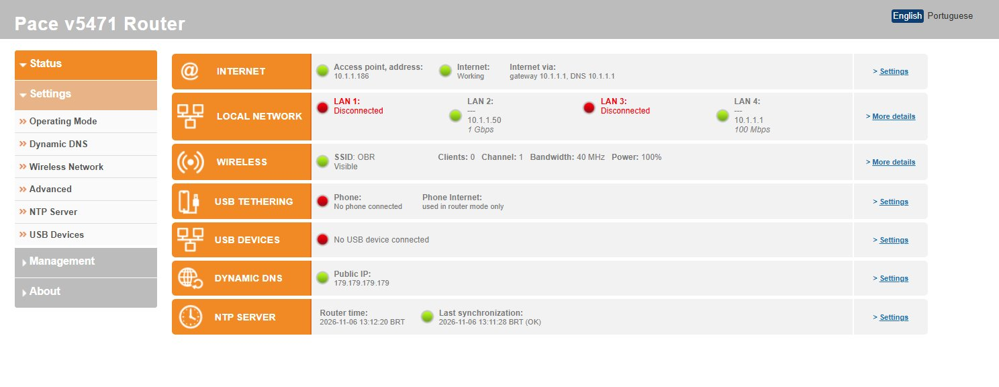
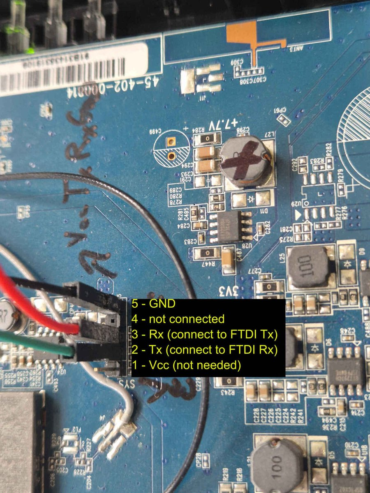
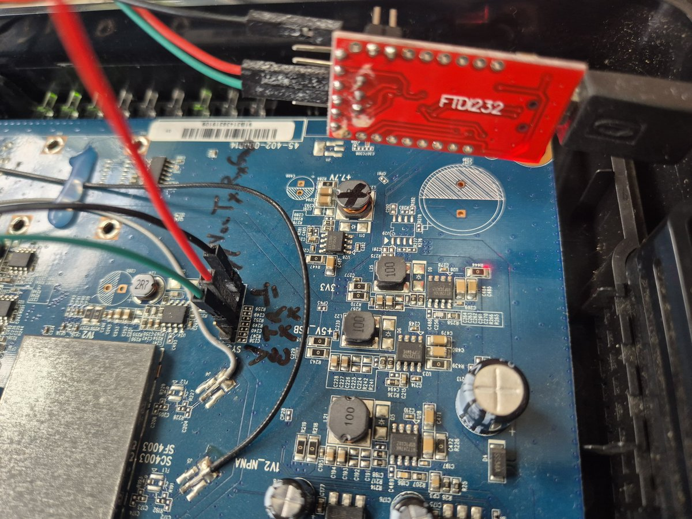

# Firmware modificado para o Pace V5471

[English](README.en.md) | **Português**

Firmware personalizado para o gateway **Pace V5471** (o "Power Box" da GVT / Vivo), que o transforma
em um **access point Wi-Fi** moderno ou em um pequeno **roteador** com failover por ancoragem USB,
DNS dinâmico, DNS sobre TLS e uma interface web refeita, em português e inglês.

É construído sobre o firmware *Alacn-181231* do [alacn1](https://github.com/alacn1) (que por sua vez
se baseia no firmware original GVT 104452), sem as partes de DSL / VoIP / IPTV / TR-069, com versões
atuais dos serviços de rede e um conjunto de páginas e serviços novos.



---

## Conteúdo

- [Hardware](#hardware)
- [Recursos](#recursos)
- [Configuração padrão](#configuração-padrão)
- [Instalação](#instalação)
  - [Abrindo a carcaça](#abrindo-a-carcaça)
  - [Console serial (UART)](#console-serial-uart)
  - [Testar sem gravar (boot pela RAM)](#testar-sem-gravar-boot-pela-ram)
  - [Gravação](#gravação)
  - [Recuperação](#recuperação)
- [Compilação](#compilação)
- [Estrutura do repositório](#estrutura-do-repositório)
- [Notas de desenvolvimento](#notas-de-desenvolvimento)
- [Limitações conhecidas](#limitações-conhecidas)
- [Créditos](#créditos)

---

## Hardware

| | |
|---|---|
| SoC | Broadcom BCM63168 (BMIPS4350, MIPS32 big-endian, 400 MHz, kernel SMP) |
| RAM / flash | 128 MB DDR3 / 128 MB NAND (Spansion S34ML01G1), dois bancos de firmware |
| Ethernet | 4 × LAN + 1 × WAN (eth4) |
| Wi-Fi | Broadcom 802.11b/g/n 2,4 GHz, 2×2, driver `wl` 6.30.102.3 |
| USB | 1 × USB 2.0 (ancoragem de celular, modem 3G, impressora) |
| Software base | Linux 2.6.30 (SDK Broadcom), busybox 1.17, sistema de configuração "configd" da Bewan |
| Código do produto | B14103 |

---

## Recursos

### Modos de operação (Configuração → Modo de Operação)
- **Access point** (padrão): o aparelho entra na rede do seu roteador principal como uma ponte;
  endereço de gerência por DHCP (ou fixo), endereço de resgate `169.254.25.1`. O Wi-Fi e as 4 portas LAN
  fazem parte da rede principal.
- **Roteador**: Internet na porta WAN por **PPPoE** (nome do serviço, VLAN, clonagem de MAC), **DHCP**
  ou **IP fixo**; LAN `192.168.25.1/24` com servidor DHCP; firewall, redirecionamento de portas, UPnP
  (desligado por padrão). Opção de **isolar da rede do lado WAN** (os computadores da LAN acessam a
  Internet, mas não os aparelhos da rede onde a porta WAN está ligada).

### Internet e USB
- **Ancoragem USB de celular Android** (módulos RNDIS / CDC Ethernet compilados para este kernel): no
  modo roteador, um celular na porta USB **assume automaticamente quando a WAN cai** e devolve a conexão
  quando ela volta (testes por cada link, endereços de monitoramento configuráveis).
- O link do celular tem firewall como a WAN (nada novo entra por ele).
- Página do modem 3G USB (APN, PIN, login).
- Servidor de impressora USB.

### Wi-Fi (Configuração → Rede Wi-Fi)
- Lista de modos de segurança com **WPA2 (melhor)** primeiro, **medidor de força** da senha e botão
  **Gerar** (16 caracteres aleatórios, ~93 bits).
- Lista de **dispositivos conectados**: nome, IP, MAC, modo 802.11 e largura do canal (pela taxa do
  link), tempo de conexão, sinal, taxa tx/rx, com botões para **Bloquear** (filtro de MAC) ou dar
  **IP fixo** (reserva no DHCP).
- **Isolamento de clientes**: um padrão para os dispositivos Wi-Fi (permitir acesso à rede local /
  isolar) e uma chave **Isolar** por dispositivo. Dispositivos isolados só acessam a Internet e o
  DNS/DHCP do roteador.
- Filtro de MAC no modo **permitir** ou **bloquear**.

### DNS e hora
- **dnsmasq 2.93** (no lugar do 2.45, de 2008) com **proteção contra DNS rebinding**.
- **DNS sobre TLS** para Cloudflare, Quad9 ou Google (encaminhador próprio sobre mbedTLS 3.6, com
  verificação de certificado e nome), na página Internet.
- Página de **DNS dinâmico** com várias contas ao mesmo tempo: dns.army / dynv6, nsupdate.info
  (IPv4 / IPv6), cPanel ou qualquer URL de atualização, além dos provedores originais. Atualiza por HTTPS
  (curl 8.10 estático com TLS 1.3 e a lista de CAs da Mozilla) a cada 5 minutos e a cada conexão,
  esperando a Internet e o relógio na inicialização; botão **Atualizar agora** e registro por conta.
- Página **Servidor NTP**: servidores, fuso horário (Brasil sem horário de verão), botão
  **Atualizar agora** com registro; sincroniza pela LAN no modo access point e pela WAN no modo roteador.
- mDNS: o aparelho responde como `<nome>.local` (padrão `paceap.local`).

### Segurança
- A senha web é pedida para troca no primeiro login; o login fica bloqueado por 30 min depois de
  5 tentativas erradas.
- **SSH** (dropbear 2026.94, chave ed25519 única de cada aparelho, mantida entre atualizações) e Telnet
  ficam **desligados** por padrão; usuário de shell separado, `shell`, com senha própria
  (Alterar Senha).
- UPnP, WPS, Telnet, TR-069 e resposta a ping pela WAN desligados; a porta sem autenticação do serviço
  de canal automático da Broadcom fechada para a rede.
- Veja em [Limitações conhecidas](#limitações-conhecidas) o que o hardware não permite (WPA3).

### Status e manutenção
- Página de **Status**: Internet (ou, no modo access point, o endereço do AP e a Internet pelo roteador
  principal), portas LAN com aparelhos e velocidade, Wi-Fi, ancoragem USB, dispositivos USB, DNS
  dinâmico, NTP. O cabeçalho mostra "Pace v5471 Access Point" ou "Pace v5471 Router" conforme o modo.
- **Aviso de erros registrados**: problemas reais encontrados nos logs (erros de script, travamentos,
  reinícios pelo watchdog) ficam guardados na flash e aparecem na página de Status como "Há X erros
  registrados que precisam ser examinados", com *Mostrar* e *Marcar como examinados*.
- **Atualização online** (Gerenciamento → Firmware): *Verificar atualização* consulta as versões
  publicadas neste repositório no GitHub e mostra as notas da versão; *Instalar* (com confirmação)
  baixa a imagem por HTTPS com verificação de certificado, confere-a e grava-a no outro banco da flash,
  reiniciando em seguida. O envio manual de um `.bin` pela mesma página também reinicia sozinho.
- **Backup / Restauração** (Gerenciamento → Backup / Restauração): baixar a configuração em um arquivo,
  restaurar de um arquivo (data e versão mostradas para confirmação), e guardar até 20 cópias no próprio
  roteador com uma descrição, para restaurar ou excluir depois. Os arquivos contêm as senhas em uma
  forma decodificável: guarde-os em local seguro.
- Histórico do sistema ordenado do mais recente para o mais antigo; descrição ao lado de cada
  configuração; interface em português / inglês com o idioma lembrado.
- O roteador principal identifica o aparelho pelo nome (`PaceAP`, opção 12 do DHCP) e pelo fabricante
  (o MAC próprio da Pace, em vez de um MAC administrado localmente).

---

## Configuração padrão

| Configuração | Padrão |
|---|---|
| Modo | Access point, endereço de gerência por DHCP do roteador principal |
| Endereço de resgate | `169.254.25.1/16` (só alcançável por um PC ligado direto por cabo, sem DHCP) |
| Interface web | `http://<endereço>/` ou `http://paceap.local/`, usuário **admin**, senha **admin** (uma nova é pedida) |
| LAN no modo roteador | `192.168.25.1/24`, DHCP `.2`–`.240` |
| Wi-Fi | conforme a etiqueta do aparelho (SSID e chave WPA); WPS desligado |
| SSH / Telnet | desligados; usuário `shell`, sem senha até ser definida em Alterar Senha |
| DNS | proteção contra rebinding ligada, DNS sobre TLS desligado |
| Hora | NTP `0/1/2.pool.ntp.org`, fuso de Brasília (UTC−3) |

Para achar o endereço do access point, procure **PaceAP** na lista de concessões DHCP do roteador
principal, ou abra `http://paceap.local/`.

---

## Instalação

> Gravar firmware personalizado pode inutilizar o aparelho se algo der errado. O V5471 tem dois bancos
> de firmware e um carregador de boot que inicia uma imagem pela rede direto na RAM, então a
> recuperação normalmente é possível — mas faça por sua conta e risco.

### Abrindo a carcaça

A tampa é presa por **2 parafusos Torx escondidos sob o adesivo de baixo** (a etiqueta da ANATEL), um
em cada extremidade. Descole a etiqueta nas pontas para alcançá-los; aqueça antes com um soprador
térmico ou um secador de cabelo se não quiser estragá-la.

### Console serial (UART)

O console serial não é necessário para instalar pela página web, mas é o jeito de ver o que o aparelho
faz e de recuperá-lo. A placa tem um conector de 5 pinos (marcado `SYS`, perto dos reguladores `3V3` /
`+5V_USB`):



| Pino | Sinal | Ligar no adaptador USB-serial |
|---|---|---|
| 5 | GND | GND |
| 4 | — | não ligado |
| 3 | Rx (o roteador recebe) | **TX** do adaptador |
| 2 | Tx (o roteador envia) | **RX** do adaptador |
| 1 | Vcc | **não ligado** (o roteador tem alimentação própria) |

- **Nível de 3,3 V**: coloque o jumper de tensão do adaptador FTDI (FT232) em **3,3 V**, nunca 5 V.
- Configuração: **115200 baud, 8N1**, sem controle de fluxo. O console dá um shell de root (`~ #`).
- Evite enviar `^` (acento circunflexo) por este console: aqui ele aciona o SysRq.



### Testar sem gravar (boot pela RAM)

O carregador de boot pode iniciar uma imagem enviada pela rede sem gravá-la na flash ("modo
multicast"):

1. Ligue o PC por cabo em uma porta **LAN** do V5471, e em nenhuma outra rede.
2. Dê ao PC um endereço fixo como `192.168.25.10/24` e deixe rodando `ping 192.168.25.1`.
3. Ligue o V5471 **segurando o botão WPS**.
4. Envie a imagem:
   ```
   python3 -I tools/v5471fw.py send work/build/cyberponk-vX.Y.Z.bin [ip-do-pc]
   ```
5. O aparelho inicia a imagem pela RAM; se algo falhar, o próximo religamento inicia pela flash.

### Gravação

A partir de um firmware alacn ou cyberponk em funcionamento (inclusive um iniciado pela RAM):

- **Interface web**: Gerenciamento → Firmware, envie `cyberponk-vX.Y.Z.bin`. A imagem vai para o banco
  mais antigo e passa a ser a próxima a iniciar; a soma de verificação é conferida antes. A partir da
  v1.3.0 o aparelho reinicia sozinho ao terminar, e *Verificar atualização* na mesma página instala as
  novas versões publicadas no GitHub.
- **Console serial**:
  ```
  cd /var/tmp && wget http://<pc>:<porta>/cyberponk-vX.Y.Z.bin -O ni.bin
  fwburn -t -v ni.bin      # confere a imagem
  fwburn -b ni.bin         # grava no banco mais antigo (cerca de 2 minutos, não desligue)
  fwburn -t -i             # os dois bancos e a ordem de boot
  reboot
  ```

As configurações são mantidas entre atualizações. A partir do **firmware original da GVT**, inicie
antes uma imagem cyberponk pela RAM e grave-a pela própria página Firmware dela.

### Recuperação

- O **outro banco** guarda o firmware anterior: se uma imagem nova não funcionar, o carregador inicia o
  banco com soma de verificação válida, e uma imagem anterior pode ser gravada de novo pela página web
  ou pelo console.
- O **boot pela RAM** (acima) funciona mesmo quando nenhum dos bancos inicia direito.
- **Restaurar padrão de fábrica**: Gerenciamento → Reiniciar, ou segure o botão reset; o aparelho volta
  no modo access point com a configuração padrão acima.

---

## Compilação

A compilação roda em Linux sem root (dono e arquivos de dispositivo ficam num arquivo de estado do
fakeroot).

**Necessário:** Python 3 (Pillow só para `tools/re/icons.py`), `fakeroot`, `squashfs-tools`
(`unsquashfs` / `mksquashfs` com LZMA), `openssl`, `node` (testes das páginas), `dash` (verificação de
sintaxe dos scripts).

**Entradas que não estão no git:**

| Caminho | O que é |
|---|---|
| `Downloads 2026-10-26/alacn1/alacn-181231-g7b2ba89.bin` | imagem Alacn-181231 do alacn1 (do projeto `pace_v5471` do alacn1): kernel, cabeçalho e base do sistema de arquivos |
| `work/toolchain/mips32--musl--stable-2018.02-2/` | toolchain musl da Bootlin: binários estáticos que rodam no kernel 2.6.30 |
| `work/toolchain/mips32--glibc--stable-2018.02-2/` | toolchain glibc da Bootlin: módulos do kernel |
| `work/ref/nomis/` | árvore do kernel do SDK Broadcom 4.12L.06B ([nomis/bcm963xx_4.12L.06B_consumer](https://github.com/nomis/bcm963xx_4.12L.06B_consumer)) para os módulos USB |
| `work/re/{curl,dnsmasq,dropbear}/src/` | códigos-fonte originais (conferidos por hash / assinatura GPG nos scripts de compilação) |

**Binários de terceiros** (uma vez, ou depois de mudar os scripts deles):

```
tools/re/modules/build.sh   # usbnet, cdc_ether, rndis_host (ancoragem USB)
tools/re/curl/build.sh      # curl 8.10.1 estático + mbedTLS 3.6.2, lista de CAs
tools/re/net/build.sh       # dnsmasq 2.93, dropbear 2026.94, dotproxy (DNS sobre TLS)
```

**Firmware:**

```
tools/make_rootfs.sh        # extração nova da imagem alacn + tools/strip.sh + tools/configure.py
tools/tests/run.sh          # verificações offline: lógica das páginas (DOM simulado), sintaxe JS e
                            # shell, comandos que faltam no aparelho, dependências de bibliotecas ELF
tools/build.sh              # -> work/build/cyberponk-v<VERSÃO>.bin
```

A versão vem do arquivo `VERSION` (`MAIOR.MÉDIO.MENOR`) e aparece na interface web
(`cyberponk-vX.Y.Z`): o último número sobe a cada compilação de teste, o do meio a cada versão
publicada (com tag `vX.Y.Z`).

---

## Estrutura do repositório

| Caminho | Conteúdo |
|---|---|
| `tools/configure.py` | a personalização: padrões de fábrica, acréscimos ao esquema de configuração, edições das páginas web, CSS |
| `tools/strip.sh` | recursos removidos (DSL, VoIP, TR-069, Samba, DLNA, hotspot / decodificador GVT, ...) |
| `tools/overlay/` | arquivos novos copiados para o sistema de arquivos: páginas, scripts, `tetherd`, tratadores de configuração |
| `tools/i18n_pt_BR.py` | textos em português das páginas novas (geradas a partir das em inglês) |
| `tools/descriptions.py` | as descrições das configurações mostradas nas páginas originais |
| `tools/v5471fw.py` | ferramenta de imagem: info / extract / build / envio para boot pela RAM (versão em Python do `updatefw` do alacn) |
| `tools/tests/` | testes offline |
| `tools/re/` | scripts de compilação dos binários de terceiros, código do encaminhador DNS sobre TLS, ícones, ajudantes de serial e prévia web, notas de engenharia reversa |
| `docs/images/` | imagens usadas neste README |

---

## Notas de desenvolvimento

- O configd executa os tratadores `onchange` *carregando* (source) `/etc/bewan/init.d/<serviço>` (dash,
  `set -u`): um arquivo que falta ou um `exit` quebra a trava do configd. Serviços removidos ganham
  stubs vazios, nunca são apagados.
- O `/bin/sh` é um dash modificado: um erro fatal de script, inclusive um comando que não existe, para
  o watchdog de software e o roteador reinicia cerca de um minuto depois. Scripts novos usam
  `#!/bin/ash`, e o `tools/tests/run.sh` recusa comandos que o busybox 1.17 não tem (`tee`, `cmp`,
  `readlink`, `timeout`, ...).
- Parâmetros de senha (`type="password"`) são guardados criptografados em AES-256-ECB; veja
  `bewan_encrypt()` em `tools/configure.py`.
- O firmware limpa as suas cadeias de iptables / ebtables a cada evento de WAN/LAN: as regras deste
  projeto são reaplicadas a cada 5 s (`tools/overlay/etc/bewan/lib/ni-guard`, executado pelo `tetherd`).
- Teste imagens novas pelo boot na RAM primeiro, grave só depois.

---

## Limitações conhecidas

- **Sem WPA3 / 802.11w**: o driver Broadcom de 2013 não suporta. WPA2-AES com uma senha forte é o
  melhor que este hardware oferece.
- **Só 2,4 GHz.** A maioria dos celulares usa canais de 20 MHz em 2,4 GHz mesmo quando o AP oferece
  40 MHz.
- **Isolamento Wi-Fi**: o driver só consegue separar todos os clientes Wi-Fi entre si de uma vez;
  então, enquanto algum dispositivo estiver isolado, os dispositivos Wi-Fi não se acessam entre si
  (os cabeados continuam acessando os permitidos).
- Kernel (2.6.30) e busybox (1.17) antigos: binários novos precisam ser estáticos com musl; os scripts
  precisam evitar comandos que o busybox não tem (os testes verificam).
- PPPoE e IPv6 na WAN estão implementados, mas foram menos testados que o DHCP.

---

## Créditos

- **alacn1** — o firmware Alacn em que este se baseia, e o formato da imagem / ferramenta de boot pela
  RAM.
- **nomis** — a árvore publicada do SDK Broadcom 4.12L usada para compilar os módulos do kernel.
- dnsmasq (Simon Kelley), Dropbear (Matt Johnston), curl, Mbed TLS, BusyBox e os demais componentes de
  código aberto; Bewan / Pace / Broadcom pelo firmware original.

Este projeto não tem relação com a Pace, Arris, GVT ou Vivo.
